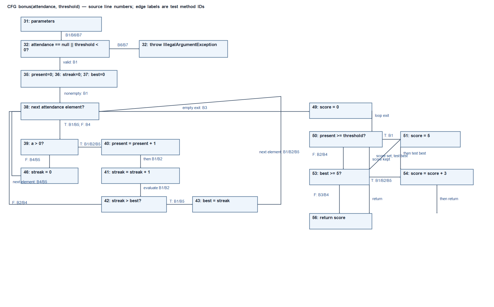

# Лаборатори №10 — Data Flow Testing (Definition–Use)

Оюутан: О. Доржсамбуу  
Код: B232270071  
Орчин: `java -version`:

```text
openjdk version "25.0.2" 2026-01-20 LTS
OpenJDK Runtime Environment Temurin-25.0.2+10 (build 25.0.2+10-LTS)
OpenJDK 64-Bit Server VM Temurin-25.0.2+10 (build 25.0.2+10-LTS, mixed mode, sharing)
```

`mvn -version`:

```text
Access is denied.
Apache Maven 3.9.16 (2bdd9fddda4b155ebf8000e807eb73fd829a51d5)
Maven home: C:\Program Files\Apache\Maven\apache-maven-3.9.16
Java version: 25.0.2, vendor: Eclipse Adoptium, runtime: C:\Users\User\AppData\Local\Programs\Eclipse Adoptium\jdk-25.0.2.10-hotspot
Default locale: en_US, platform encoding: UTF-8
OS name: "windows 11", version: "10.0", arch: "amd64", family: "windows"
```

## A. gcd: all-DU-pairs

Мөрийн дугаар нь `DataFlowTargets.java` файлынх. `gcd(7,0)` ганцаараа `x`-ийн 13-р мөрийн тодорхойлолтоос 20-р мөрийн `return` хүртэлх шууд DU хосыг хамарна. `gcd(12,8)` хоёр давталттай (12%8=4, 8%4=0); хоёр давталт шаардах хосуудад x(17→16), y(18→15/16), tmp(16→18) орно.

| Хувьсагч | Def | Use | Төрөл | Def-clear зам | Тест | Хамрагдсан |
|---|---:|---:|---|---|---|---|
| x | 13 | 16 | c | 13→15(T)→16 | G1 | Тийм |
| x | 13 | 20 | c | 13→15(F)→20 | G2 | Тийм |
| x | 17 | 16 | c | 17→18→15(T)→16 дараагийн iteration | G1 | Тийм |
| x | 17 | 20 | c | 17→18→15(F)→20 | G1 | Тийм |
| y | 13 | 15 | p T | 13→15(T)→16 | G1 | Тийм |
| y | 13 | 15 | p F | 13→15(F)→20 | G2 | Тийм |
| y | 13 | 16 | c | 13→15(T)→16 | G1 | Тийм |
| y | 18 | 15 | p, T/F | 18→15; G1 хоёр outcome | G1 | Тийм |
| y | 18 | 16 | c | 18→15(T)→16 дараагийн iteration | G1 | Тийм |
| tmp | 16 | 18 | c | 16→17→18 | G1 | Тийм |

`G1` = `twoIterationsCoverLoopPairs`; `G2` = `xDefinitionReachesReturnWithoutLoop`. c-use нь илэрхийлэл/буцаалтын хэрэглээ, p-use нь predicate-ийн хэрэглээ. `tmp` өөрийн цорын ганц тодорхойлолтоос 18-р мөрөнд шууд уншигддаг.

Тестийн `@DisplayName`-ууд файлын мөрийн хосуудыг нэрлэсэн: G1 нь loop-ийн давталт хоорондын хосуудыг, G2 нь шууд return болон `y` predicate-ийн F outcome-ыг тэмдэглэнэ.

## B. bonus: CFG ба өгөгдлийн урсгал



### B2. Def/use жагсаалт

| Мөр | Def | Use |
|---:|---|---|
| 31 | `attendance`, `threshold` параметрийн def | — |
| 32 | — | `attendance` p-use; богино залгааны нөхцөлд `threshold` p-use |
| 35 | `present` | — |
| 36 | `streak` | — |
| 37 | `best` | — |
| 38 | iteration бүрт `a` | `attendance` p-use (дараагийн элемент байгаа эсэх) |
| 39 | — | `a` p-use |
| 40 | `present` | `present` c-use |
| 41 | `streak` | `streak` c-use |
| 42 | — | `streak`, `best` p-use |
| 43 | `best` | `streak` c-use |
| 46 | `streak` (өмнөх streak-ийн def-үүдийг kill хийнэ) | — |
| 49 | `score` | — |
| 50 | — | `present`, `threshold` p-use |
| 51 | `score` | — |
| 53 | — | `best` p-use |
| 54 | `score` | `score` c-use |
| 56 | — | `score` c-use |

`for-each`-ийн буцах ирмэг дээр дараагийн элементийг `a`-д оноох нь 38-р мөрийн шинэ def; элемент байгаа/байхгүй predicate нь `attendance`-ийн p-use.

### B3. DU хосууд

| Хувьсагч | Def | Use | Төрөл | Def-clear замын товч тайлбар | Тестийн ID |
|---|---:|---:|---|---|---|
| attendance | 31 | 32 | p T | `attendance == null` | B6 |
| attendance | 31 | 32 | p F | non-null зам | B1 |
| attendance | 31 | 38 | p T | дараагийн элемент байна | B1 |
| attendance | 31 | 38 | p F | хоосон массив | B3 |
| threshold | 31 | 32 | p T | сөрөг босго | B7 |
| threshold | 31 | 32 | p F | хүчинтэй босго | B1 |
| threshold | 31 | 50 | p T | present босго хангана | B1 |
| threshold | 31 | 50 | p F | present босго дутна | B2 |
| a | 38 | 39 | p T | эерэг ирц | B1 |
| a | 38 | 39 | p F | zero attendance | B4 |
| present | 35 | 40 | c | эхний эерэг элементийн өмнө өөр def үгүй | B1 |
| present | 35 | 50 | p T | empty, threshold=0 | B3 |
| present | 35 | 50 | p F | бүх элемент zero, threshold=1 | B8 |
| present | 40 | 40 | c | дараалсан хоёр эерэг элементийн хооронд | B1 |
| present | 40 | 50 | p T | босго хангана | B1 |
| present | 40 | 50 | p F | босго дутна | B2 |
| streak | 36 | 41 | c | эхний элемент эерэг | B1 |
| streak | 36 | 42 | — | **Биелэшгүй:** 42-оос өмнө 41 дэх def үргэлж үүснэ | — |
| streak | 36 | 46 | — | 46 дахь assignment streak-ийн утгыг уншихгүй | — |
| streak | 41 | 41 | c | дараалсан эерэг өдрийн дараагийн increment | B1 |
| streak | 41 | 42 | p T | урт streak | B1 |
| streak | 41 | 42 | p F | reset-ийн дараах богино streak | B4 |
| streak | 41 | 46 | — | 46 дахь assignment нь streak-ийн use биш | — |
| streak | 46 | 41 | c | таслалтын дараах эерэг өдрийн increment | B1, B5 |
| streak | 46 | 42 | — | **Биелэшгүй:** эерэг бол 41 дэх def түрүүлж kill хийнэ; үгүй бол 42 хүрэхгүй | — |
| best | 37 | 42 | p T | эхний эерэг өдөр `1 > 0` | B1 |
| best | 37 | 42 | p F | **Биелэшгүй:** эхний эерэг өдөр 43 дахь def; zero бол 42 хүрэхгүй | — |
| best | 43 | 42 | p T | streak best-ээс их | B1 |
| best | 43 | 42 | p F | reset-ийн дараах streak best-ээс их биш | B4 |
| best | 37 | 53 | p F | урт streak үүсээгүй | B3 |
| best | 37 | 53 | p T | **Биелэшгүй:** best≥5 болохын тулд 43 дахь def заавал үүснэ | — |
| best | 43 | 53 | p T | best 5 ба түүнээс урт | B1, B5 |
| best | 43 | 53 | p F | шинэчлэгдсэн best 5 хүрээгүй | B4 |
| score | 49 | 54 | c | present босго дутуу, streak≥5 | B2 |
| score | 49 | 56 | c | present босго дутуу, streak<5 | B4 |
| score | 51 | 54 | c | present босго хангаж, streak≥5 | B1 |
| score | 51 | 56 | c | threshold=0, empty; best<5 | B3 |
| score | 54 | 56 | c | нийлбэрийг return хийх | B1, B2 |

Тестийн method ID нь method-ийн нэртэй ижил: B1–B8. B9 нь all-DU minimum-д шаардагдахгүй, M2 мутантыг ялгахад нэмсэн. Мөр 46 дахь `streak=0` нь өмнөх streak-ийн def-үүдийг kill хийнэ. 46→41 хос биелнэ: `streak = streak + 1`-ийн баруун тал шинэ def үүсэхээс өмнө c-use хийнэ. `—` мөрүүд DU pair биш; боломжгүй predicate outcome-ыг тусад нь үндэслэв.

### B4. All-defs ба all-DU-pairs

All-defs-д `BonusTest`-ийн 2 тест шаардлагатай. `score=0` (49)-ийн def нэг гүйцэтгэлд score=5 (51)-ээр заавал kill хийгдэх эсвэл 54-д хүрч use болохын аль нэг тул score init def-ийг ашиглах замд present босгыг алдах хэрэгтэй. Score=5 def-ийг хэрэглэхийн тулд босгыг хангах хэрэгтэй. Иймээс хамгийн багадаа хоёр өөр гүйцэтгэл шаардлагатай: B1 босго хангана, B2 босго алдана. B1 нь streak reset, дараалсан streak, loop true/false болон score нэмэх замуудыг хамарна.

`jacoco-alldefs.csv`: Branch 13/16 хамрагдсан, 3 missed; Line 22 хамрагдсан, 2 missed (invalid input-ийн throw болон далд constructor). All-defs биелсэн ч branch 100% биш. Branch 100% болсон ч DU хос орхигдож болно: zero элемент байгаа ч өмнө нь positive байвал `present`-ийн 35-р мөрийн def 40-р мөрөнд дахин тодорхойлогдоно. Ийм өгөгдлөөр `a>0`-ийн false салбарыг авч, бусад салааг хамарсан ч 35→50 p-use DU хосыг алдаж болно; үүнийг empty эсвэл бүхэлдээ zero массив л хамарна. JaCoCo control-flow салааг л тоолдог, def–use холбоосыг хэмждэггүй.

## C. Fault seeding

| Мутаци | Төрөл | Тестийн үр дүн | Бодит алдаа / тайлбар |
|---|---|---|---|
| M1: 41-р мөрийн streak update-ийг устгав | missing update | 10 тест, 3 failure; B1, B2, B5 уналаа | B1: expected 8, was 5; B2: expected 3, was 0; B5: expected 3, was 0 (`results/mvn-test-M1.txt`) |
| M2: `best = streak`-ийг `best = present` болгов | wrong variable | эхний 10 тест амьд үлдсэн (`results/mvn-test-M2.txt`); B9 нэмсний дараа 11 тест, 1 failure (`results/mvn-test-M2-kill.txt`) | Эхний suite-д best утга 5 ба 6 болж зөрсөн ч зөвхөн `best >= 5`-ийг ажигласан тул оноо адил байв. B9 `[1,0,1,1,1,1]`, threshold=6 дээр зөв best=4, мутант best=5 болж, expected 0, was 3 гэж унав. |
| M3: return-ийн өмнө ашиглагдаагүй `int total = present + best;` нэмэв | dead definition | 10 тест бүгд ногоон (`results/mvn-test-M3.txt`) | `total` use-д хүрэхгүй тул runtime үр дүнд нөлөөлөхгүй. VS Code-ийн Red Hat Java extension-д багтдаг Eclipse JDT compiler-ийн бодит diagnostic (`results/m3-jdt-warning.txt`): **“The value of the local variable total is not used”**. `javac -Xlint:all` энэ unused local-д warning өгөөгүй. |

Мутаци бүрийн дараа `DataFlowTargets.java`-г Starter commit-оос `git restore`-оор буцаасан. Эцсийн эх файл Starter хувилбартай ижил.

## B5. Эцсийн хамралт

`jacoco-alldefs.csv`: Branch missed 3, covered 13 (16 нийт); Line missed 2, covered 22. `jacoco-final.csv`: Branch missed 0, covered 16; Line missed 1, covered 23. Үлдсэн нэг мөр нь 7-р мөрийн implicit constructor; source method-уудад үлдсэн branch байхгүй.

## Дүгнэлт

DU анализ нь салбарын оролтыг тоолохоос илүүгээр тодорхойлолтын утга ямар замаар аль хэрэглээнд хүрснийг батална. Branch coverage 100% байсан ч `present`-ийн 35-р мөрийн def-ээс 50-р мөрийн predicate хүртэлх хос орхигдож болно, хэрэв бүх zero элементтэй массив ажиллуулаагүй бол. DU анализд def-clear зам, давтан тодорхойлолтын kill, predicate-ийн тус бүрийн outcome-ыг гараар дагах шаардлагатай тул JaCoCo branch хэмжүүрээс илүү цаг авсан. All-defs-д хоёр BonusTest хэрэгтэй болсон нь score-ийн эхний болон 5 онооны def-үүдийг нэг гүйцэтгэлд хоёуланг нь use-д хүргэх боломжгүйтэй холбоотой. M2 бүх эхний DU тестийг давсан нь зөв утга 4, буруу утга 5 байхад хэрэглэгчид харагдах шалгалт зөвхөн `>=5` байсан учраас юм. B9 энэ ялгааг оноонд нөлөөлүүлэхээр өгөгдөл сонгож алдааг илрүүлсэн. Эцсийн 11 тест ногоон, JaCoCo branch 16/16, source-ийн ганц missed line нь implicit constructor байна.

## Төгсгөлд

AI ашигласан хэсэг: шаардлагын жагсаалт болон DU хүснэгт, тест, CFG-ийн эхний ноорог гаргуулсан; эцсийн зам, test ID, тестийн гаралт, branch/line тоонуудыг код, Maven лог, JaCoCo CSV-тэй тулгаж зассан.

